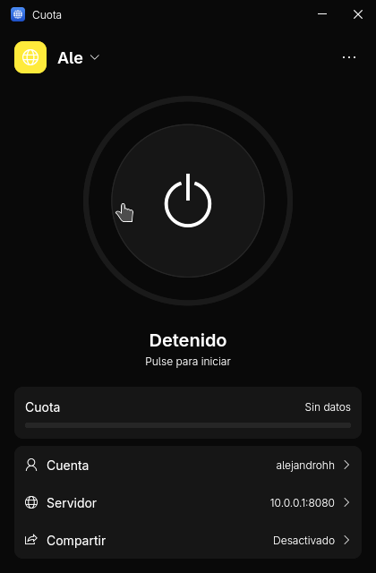
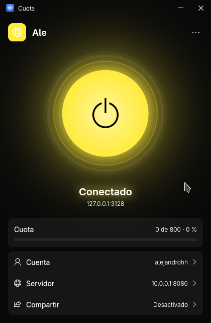
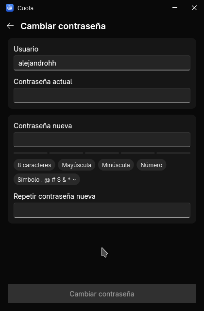
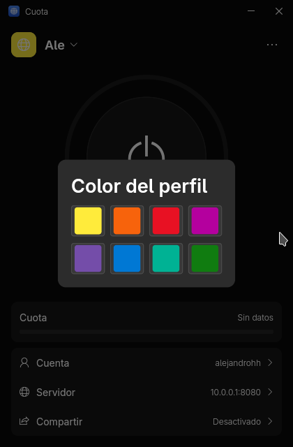
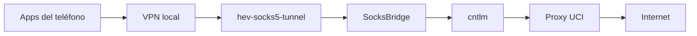

<div align="center">


# Cuota

**Interfaz gráfica para `cntlm` y medidor de cuota para la Universidad de las Ciencias Informáticas (UCI).**

Conéctate al proxy de la universidad con un clic, consulta tu cuota y comparte o tuneliza tu conexión, en el escritorio y en Android.

[](https://flutter.dev)
[](https://dart.dev)
[](#plataformas)
[](LICENCE)
[](https://github.com/kurokykun/cuota/actions/workflows/build.yml)

[Funciones](#funciones) · [Descargar](#descargar) · [Compilar](#compilar) · [Cómo funciona](#cómo-funciona) · [Solución de problemas](#solución-de-problemas) · [Contribuir](#contribuir)

</div>

<br>

<div align="center">
<table>
  <tr>
    <td align="center"><br><sub><b>Detenido</b></sub></td>
    <td align="center"><br><sub><b>Conectado</b></sub></td>
    <td align="center"><br><sub><b>Cambiar contraseña</b></sub></td>
    <td align="center"><br><sub><b>Color del perfil</b></sub></td>
  </tr>
</table>
</div>

## Funciones

| | |
|---|---|
| **Proxy con un clic** | Inicia y detiene `cntlm` sin tocar archivos de configuración. Avisa si el puerto está ocupado, si falta el programa o si el proxy se detiene. |
| **Cuota en tiempo real** | Consulta el consumo cada minuto y avisa con color cuando se acerca al límite. |
| **Varios perfiles** | Cada uno con su cuenta, servidor, exclusiones y color. Los cambios se guardan solos. |
| **Túnel en Android** | Una VPN local envía el tráfico TCP del teléfono por el proxy, sin root. |
| **Compartir en la red** | Modo gateway para que otros equipos autorizados usen tu proxy. |
| **Cambio de contraseña** | Cambia la contraseña de tu cuenta UCI desde la app, con los requisitos a la vista. |
| **Registro exportable** | Consulta la actividad y expórtala a `.txt` para reportar problemas. Oculta tu usuario, contraseña y hashes. |
| **Contraseñas protegidas** | Se guardan en el llavero del sistema, y `cntlm` solo recibe hashes. |

## Plataformas

| Plataforma | Estado | Notas |
|---|---|---|
| **Linux** | ✅ Principal | Con bandeja del sistema |
| **Android 10+** | ✅ Funcional | Túnel VPN local |
| **Windows** | ⚠️ En pruebas | Se compila en cada release, pero aún no se ha probado su funcionamiento |
| **macOS** | ⚠️ Sin probar | No se ha compilado en esta versión |

## Descargar

Las versiones listas para probar de Android, Linux y Windows están en [**Releases**](https://github.com/kurokykun/cuota/releases).

## Compilar

### Requisitos comunes

- [Flutter](https://docs.flutter.dev/get-started/install) **3.47 o superior** (Dart 3.13+)
- Git

```bash
git clone https://github.com/kurokykun/cuota.git
cd cuota
flutter pub get
```

### Linux

Instala las dependencias:

```bash
# Debian / Ubuntu
sudo apt install clang cmake ninja-build pkg-config libgtk-3-dev \
  libayatana-appindicator3-dev libsecret-1-dev gnome-keyring cntlm

# Arch / Manjaro (cntlm puede estar en AUR)
sudo pacman -S --needed clang cmake ninja pkgconf gtk3 \
  libayatana-appindicator libsecret gnome-keyring
```

Compila y ejecuta:

```bash
flutter build linux --release
./build/linux/x64/release/bundle/cuota
```

> La app necesita el programa `cntlm` en el `PATH` y un servicio de llavero activo (por ejemplo, `gnome-keyring`) para recordar las contraseñas.

### Android

Además de Flutter, necesitas el Android SDK, el **NDK 28.2.13676358** y `curl`. El túnel depende de dos piezas nativas que no se compilan con Flutter: `cntlm` y `hev-socks5-tunnel`. Este script las prepara:

```bash
export ANDROID_HOME="$HOME/Android/Sdk"   # la ruta de tu SDK
android/native/setup_native.sh
```

> El script descarga código de GitHub y compila `cntlm` en tu equipo. Conviene leerlo antes de ejecutarlo. Solo hace falta si `android/app/libs/hev-socks5-tunnel.aar` o `android/app/src/main/jniLibs/` no existen, o al actualizar esas versiones.

Compila el APK:

```bash
flutter build apk --release
# build/app/outputs/flutter-apk/app-release.apk
```

La primera vez que inicies el proxy, Android pedirá autorizar la VPN. El APK resultante está firmado con la clave de depuración: sirve para instalarlo, pero no para publicarlo en una tienda.

### Windows

Necesitas Visual Studio con la carga de trabajo *Desktop development with C++*. `cntlm.exe` ya va incluido en el repositorio.

```powershell
flutter build windows --release
```

## Cómo funciona

### Escritorio

La app genera una configuración temporal con hashes de tu contraseña, inicia `cntlm` y comprueba que el puerto responde antes de darlo por activo. Configura tus programas para usar `127.0.0.1:3128`.

### Túnel en Android



El proxy de la UCI rechaza `CONNECT` en el puerto 80, así que `SocksBridge` envía ese tráfico como HTTP normal y el resto por `CONNECT`.

**Limitaciones del túnel:**

- Solo transporta TCP. El tráfico UDP, como llamadas de voz o algunos juegos, no pasa; QUIC normalmente recurre a TCP.
- Los puertos que el proxy prohíba fallarán. Por ejemplo, IMAP con SSL (993) y 8443 están bloqueados.
- Las redes privadas (`10.0.0.0/8`, `172.16.0.0/12`, `192.168.0.0/16`) quedan fuera del túnel.
- Otras apps del mismo teléfono podrían usar `127.0.0.1:3128` mientras el proxy esté activo.

### Compartir en la red

Activa **Compartir** e indica qué equipos pueden conectarse, por IP (`192.168.1.20`) o por red (`192.168.1.0/24`).

> Quien se conecte navegará **con tu usuario y consumirá tu cuota**. Por eso la lista es obligatoria y la app rechaza redes más amplias que `/8`. El firewall de tu equipo debe permitir conexiones entrantes a ese puerto.

### Certificados

Los servidores de la UCI usan una cadena de certificados propia, que los sistemas no reconocen de serie. La app verifica siempre el certificado y lleva incluida esa cadena en [`assets/certs/`](assets/certs):

| Certificado | Vence |
|---|---|
| Autoridad de Certificación Servicio Central Cifrado (raíz) | diciembre de 2030 |
| ROOT AC UCI (intermedia) | agosto de 2028 |

Para añadir otro, copia el `.pem` a esa carpeta y recompila. En escritorio también puedes dejarlo en `~/Cuota/certs/`.

## Datos y privacidad

| Dato | Dónde se guarda |
|---|---|
| Perfiles, sin contraseña | `~/Cuota/*.conf` en escritorio, y carpeta privada de la app en Android |
| Contraseñas | Llavero del sistema |
| Configuración de `cntlm` | Archivo temporal privado con hashes, que se borra al arrancar |
| Registro | Solo en memoria, hasta que lo exportes |

Los perfiles de versiones anteriores se migran solos: la contraseña pasa al llavero y desaparece del archivo.

Antes de compartir un registro, revísalo: en Android incluye los sitios rechazados por el proxy.

## Estructura del proyecto

El código sigue **Clean Architecture** por funcionalidad, con **Riverpod** para el estado:

```
lib/
├── core/            Errores, red segura, rutas y componentes comunes
└── features/
    ├── account/     Cambio de contraseña
    ├── logs/        Registro y exportación
    ├── profiles/    Perfiles, ajustes y pantalla principal
    ├── proxy/       cntlm, gateway de Android y botón de encendido
    └── quota/       Consulta de cuota

Cada funcionalidad se divide en domain/, data/ y presentation/.

android/app/src/main/kotlin/   VpnService y SocksBridge
android/native/                Script de las piezas nativas
images/                        Iconos (app.svg, tray.svg y generate_icons.sh)
```

### Comandos útiles

```bash
flutter analyze                 # análisis estático
flutter test --concurrency=1    # tests; algunos usan el cntlm real si está instalado
images/generate_icons.sh        # regenera los iconos (requiere librsvg e ImageMagick)
```

## Solución de problemas

| Síntoma | Qué revisar |
|---|---|
| **El puerto 3128 ya está en uso** | Otro programa o una segunda ventana de Cuota lo ocupa. Ciérralo o cambia el puerto en *Servidor*. |
| **No se encontró el programa cntlm** | Instala `cntlm` y comprueba que esté en el `PATH`. |
| **No se pudo conectar con el servidor** | La consulta de cuota necesita llegar a `cuotas.uci.cu`, normalmente desde la red de la UCI. |
| **No se pudo confirmar que el servidor sea seguro** | El servidor usa otra cadena de certificados. Añade el `.pem` nuevo. |
| **Sin cuota** o redirección a `block.uci.cu` | El proxy te autentica, pero está bloqueando la navegación. |
| **No se recuerda la contraseña** | Comprueba que haya un servicio de llavero activo. |
| **Otro equipo no se conecta al gateway** | Revisa la lista de equipos permitidos y el firewall. |

Para cualquier otro caso, abre **⋯ → Ver registro**, exporta el archivo y adjúntalo a tu reporte. En Linux también ayuda esto:

```bash
journalctl --since "-10 min" | grep cntlm
```

## Contribuir

Las contribuciones son bienvenidas. Abre un [issue](https://github.com/kurokykun/cuota/issues) para reportar un problema o proponer una mejora, o envía un pull request. Antes de enviarlo, comprueba que pasen `flutter analyze` y `flutter test`.

## Licencia y componentes de terceros

Cuota se distribuye bajo la licencia [BSD 3-Clause](LICENCE). Incluye o descarga estos componentes, con sus propias licencias:

| Componente | Uso | Licencia |
|---|---|---|
| [cntlm](https://github.com/versat/cntlm) | Proxy de autenticación NTLM | GPLv2 |
| [hev-socks5-tunnel](https://github.com/heiher/hev-socks5-tunnel) | Túnel de Android | MIT |

Si distribuyes la app con `cntlm`, debes cumplir también su licencia GPLv2.

<div align="center"><sub>Hecho con Flutter para la comunidad de la UCI</sub></div>
