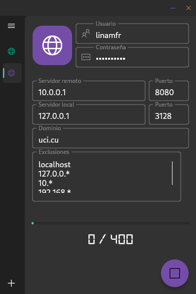
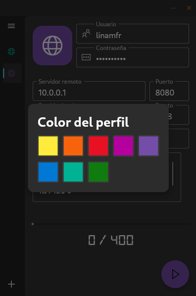

# Cuota

A cntlm graphic user interface written in flutter and quota managment for the  Informatic Sciences University,with suport for multiple proxy profiles.

## Compilation

Requires Flutter 3.47 or newer. On Linux you also need the cntlm binary in your PATH and ayatana-appindicator3-0.1 (libayatana-appindicator3-dev on Debian/Ubuntu, libayatana-appindicator on Arch/Manjaro) for system tray support.

On Android, first run `android/native/setup_native.sh`. It downloads hev-socks5-tunnel and builds cntlm (GPLv2) from source with the NDK.

## Features
- Proxy Profile Manager
- Cuota check
- Field validation
- Color profiler picker

## Contribute
Feel free to file an issue if you find a problem or make pull requests.

All contributions are welcome :D
